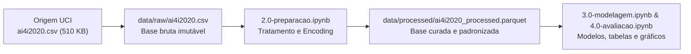

# Fonte de dados

Esta página descreve **de onde vêm os dados** do projeto: a origem, como ela está
organizada, qual é o grão de cada registro e como a carga é reproduzida.


## Origem

<span style="color:red">**O dataset utilizado é o **AI4I 2020 Predictive Maintenance Dataset**, disponibilizado publicamente pelo UCI Machine Learning Repository (UCI ID 601) sob licença Creative Commons Attribution 4.0 International (CC BY 4.0). Ele reflete um cenário sintético, porém extremamente realista, de medições operacionais de uma planta industrial.**</span>

```
data/raw/ai4i2020.csv
```


### Extração vigente

A extração em uso compreende o arquivo integral `ai4i2020.csv` extraído em Outubro/2026 do repositório UCI. Trata-se da carga inicial do projeto, contendo todos os 10.000 registros e 14 colunas originais sem remoções ou alterações no arquivo bruto.

| Coluna | Conteúdo |
|:---|:---|
| `UDI` | Identificador único do registro (variando de 1 a 10.000) |
| `Product ID` | Código do produto combinando a letra da variante e o número de série |
| `Type` | Variante de qualidade do produto (`L` = Low, `M` = Medium, `H` = High) |
| `Air temperature [K]` | Temperatura do ar ambiente medida em Kelvin (K) |
| `Process temperature [K]` | Temperatura do processo industrial medida em Kelvin (K) |
| `Rotational speed [rpm]` | Velocidade de rotação do eixo da máquina em rotações por minuto (rpm) |
| `Torque [Nm]` | Torque gerado pelo motor medido em Newton-metro (Nm) |
| `Tool wear [min]` | Tempo acumulado de desgaste da ferramenta de corte em minutos |
| `Machine failure` | Rótulo binário de falha geral do equipamento (0 = Não, 1 = Sim) |
| `TWF` | Falha por Desgaste da Ferramenta (*Tool Wear Failure*) |
| `HDF` | Falha por Dissipação de Calor / Sobreaquecimento (*Heat Dissipation Failure*) |
| `PWF` | Falha por Potência de Operação (*Power Failure*) |
| `OSF` | Falha por Sobrecarga de Tensão (*Overstrain Failure*) |
| `RNF` | Falha Aleatória não enquadrada nos modos anteriores (*Random Failure*) |

## Organização da origem

O conjunto de dados de origem é disponibilizado no repositório UCI sob a forma de um ficheiro CSV único e estruturado (*flat file*), sem particionamento de rede ou esquemas de pastas complexos. No projeto local, a estrutura de diretórios armazena os dados brutos na pasta `data/raw/` e os dados tratados em `data/processed/`.

```text
data/
├── raw/
│   └── ai4i2020.csv
└── processed/
    └── ai4i2020_processed.parquet
```

| Característica | Valor |
|:---|---:|
| Partições | 1 |
| Arquivos | 1 |
| Registros | 10.000 |
| Colunas | 14 |
| Volume na origem | ~510 KB |
| Período | Ciclos de máquina padronizados |

## Grão e conteúdo

Cada linha é um **ciclo operacional individual de usinagem da máquina** (`UDI`).

A tabela encontra-se desnormalizada e agrupa variáveis de caracterização do produto (dimensão de qualidade `Type` e identificador `Product ID`), sensores contínuos de operação (temperaturas, rotação, torque e desgaste de ferramenta) e o registo histórico de falhas e seus respetivos modos.

As métricas aditivas são:

| Métrica | Descrição |
|:---|:---|
| `Air temperature [K]` | Medição da temperatura do ar ambiente medida em Kelvin (K) |
| `Process temperature [K]` | Medição da temperatura do processo industrial medida em Kelvin (K) |
| `Rotational speed [rpm]` | Velocidade de rotação do eixo da máquina medida em rotações por minuto (rpm) |
| `Torque [Nm]` | Torque gerado pelo motor medido em Newton-metro (Nm) |
| `Tool wear [min]` | Tempo acumulado de utilização da ferramenta de corte medido em minutos (min) |

## Fluxo de dados no projeto




## Fontes complementares

Dados que não vêm da origem principal, mas entram na análise.

| Arquivo | Conteúdo |
|:---|:---|
| `Nenhum` | Todas as variáveis necessárias estão contidas no ficheiro único ai4i2020.csv |

## Reprodução

```bash
# Sincronizar o ambiente e instalar dependências do projeto
uv sync

# Executar a pipeline de preparação dos dados
uv run jupyter execute notebooks/2.0-preparacao.ipynb

# Executar a modelagem e a avaliação dos clusters
uv run jupyter execute notebooks/3.0-modelagem.ipynb
uv run jupyter execute notebooks/4.0-avaliacao.ipynb
```
