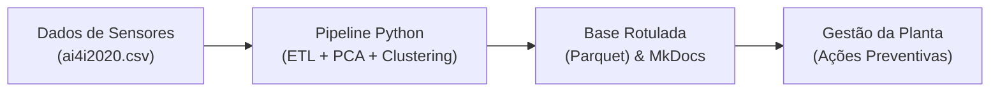

# Implementação

Um resultado só é útil quando quem decide consegue acessá-lo. Esta página descreve **como a entrega chega ao usuário**, como ela é mantida em funcionamento e como o projeto é encerrado.

---

## Plano de implantação

A entrega final do projeto é realizada através de uma **Documentação Viva e Interativa (MkDocs)** integrada ao repositório GitHub, combinada com a geração de datasets curados e rotulados em formato Parquet para consumo dos times de Engenharia de Manutenção e Business Intelligence.

| Entrega | Consumidor | Meio | Frequência |
|:---|:---|:---|:---|
| **Documentação Viva e Mapeamento de Regimes** | Engenharia de Manutenção / Gestão da Planta | Site MkDocs / Repositório Git | Sob demanda / Atualização por release |
| **Bases Curadas com Clusters e Anomalias** | Analistas de BI e Confiabilidade | Arquivos Parquet em `data/processed/` | Mensal / Reexecução de pipeline |

**A atualização dos artefatos é disparada via execução manual da pipeline local pelo gerenciador uv ou via versionamento no GitHub. O site de documentação é publicado e hospedado estaticamente a partir dos arquivos Markdown da pasta docs/.**

## Monitoramento e manutenção

**Para garantir que a segmentação e a detecção de anomalias continuem refletindo as condições reais de operação das máquinas no chão de fábrica, estabelece-se o seguinte plano de acompanhamento:**

| O que monitorar | Como | Periodicidade | Ação se desviar |
|:---|:---|:---|:---|
| Volumetria e Integridade | Validação da contagem de registros e ausência de nulos na ingestão | Mensal | Notificar Engenharia de Dados se houver perda de telemetria de sensores |
| Desvio de Distribuição (Drift) | Comparação de média e desvio padrão das temperaturas e torque com a base de treino | Trimestral | Avaliar recalibragem de sensores ou retreinamento do modelo |
| Proporção do Cluster Crítico | Monitorar se a porcentagem do Cluster 0 oscila além de 30% da frota | Mensal | Notificar a equipe de manutenção para checar sistema de refrigeração geral |

??? note "O que costuma ser monitorado"
    - **execução**: a carga rodou, no horário previsto, sem erro;
    - **volumetria**: o volume recebido está dentro do esperado — queda brusca costuma ser
      falha de origem, não mudança de comportamento;
    - **qualidade**: percentual de nulos e cardinalidade das dimensões-chave estáveis;
    - **desempenho do modelo**, quando houver: as métricas se mantêm em produção;
    - **desvio de distribuição**: os dados de entrada continuam parecidos com os de treino.

**Em caso de falha de pipeline ou inconformidade de formato na chegada dos dados brutos, a equipe técnica é acionada por e-mail, e a versão anterior da base curada em data/processed/ permanece como última versão válida.**

### Retreinamento

**O retreinamento dos modelos não supervisionados (K-Means e DBSCAN) deve ocorrer semestralmente por calendário ou de forma reativa caso a distribuição estatística das variáveis numéricas (temperatura e torque) apresente variação ($z\text{-score} > 2.0$) em relação aos parâmetros originais do StandardScaler.**

## Relatório final

**A documentação viva em MkDocs consolida integralmente todas as fases do ciclo Crisp-DM do projeto.**

| Artefato | Local |
|:---|:---|
| Relatório Final CRISP-DM | `docs/index.md e páginas navegáveis do MkDocs` |
| Notebooks de Execução e Código | `notebooks/1.0-eda.ipynb até 4.0-avaliacao.ipynb` |
| Gráficos e Figuras Salvas | `reports/figures/ e docs/imagens/` |

## Revisão do projeto

Retrospectiva de fechamento — o que levar para o próximo projeto.

- **O que deu certo:**

— O uso do gerenciador de pacotes uv, permitindo configurar o ambiente virtual e instalar dependências do projeto em instantes em máquinas recém-formatadas.

—  O cumprimento estrito das regras de aprendizado não supervisionado (PBL), isolando completamente identificadores e rótulos de falha durante a clusterização.

—  A combinação entre K-Means e DBSCAN, que permitiu simultaneamente mapear os regimes operacionais e isolar 110 anomalias pontuais.

- **O que poderia ter sido melhor:**

— A integração automatizada (CI/CD) para publicação automática do MkDocs no GitHub Pages poderia ter sido configurada desde a primeira fase.

- **O que fazer diferente:**

— Em projetos futuros, estruturar scripts Python utilitários na pasta src/ para modularizar as funções de pré-processamento e geração de gráficos, deixando os notebooks ainda mais limpos.

**Responsabilidades e Pontos de Contato pós-encerramento:**

* **Manutenção do Código e Modelos:** Carlos Emanuel (Cientista de Dados)
* **Governança e Acesso aos Dados (Data Pipeline):** Higor Rafael (Engenheiro de Dados)
* **Repositório de Dados Brutos:** `data/raw/` (Cópia imutável mantida e gerenciada no repositório do projeto por Carlos Emanuel)
