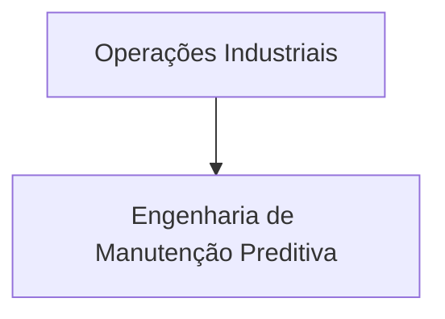

# Manutenção Preditiva Industrial — Tema 10 (AI4I 2020)

## Introdução

**Este projeto aplica técnicas de **Aprendizado Não Supervisionado** (Agrupamento e Redução de Dimensionalidade) para identificar regimes operacionais de máquinas industriais e detectar comportamentos anômalos antes que resultem em paradas não planejadas.**

## Dados do projeto

**O estudo utiliza o dataset **AI4I 2020 Predictive Maintenance** (UCI Machine Learning Repository), composto por 10.000 registros de ciclos de máquina e 14 colunas com variáveis operacionais de sensores e registros de falhas.**

### Levantamento inicial

!!! info "Tipo do projeto"
    - [x] Análise exploratória
    - [ ] Modelo preditivo
    - [ ] Modelo de classificação
    - [x] Modelo de agrupamento
    - [x] Detecção de anomalias

### Nível de acesso

!!! warning "Confidencialidade"
    - [x] Público
    - [ ] Interno (toda a organização)
    - [ ] Restrito (apenas a área requisitante)

### Objetivos de negócio

!!! quote ""
     Mapear e segmentar os regimes operacionais da fábrica sem utilizar rótulos prévios.
* Identificar o regime de maior risco térmico/operacional (Cluster 0) para direcionar a manutenção preventiva.
* Reduzir paradas não planejadas atuando diretamente na causa de 60,47% das falhas da planta.

## Sobre o projeto

### Histórico do documento

| Data | Versão | Descrição | Autor |
| :--- | :---: | :--- | :--- |
| 13/10/2026 | 0.1 | Configuração do ambiente virtual (`uv`), estrutura do repositório e MkDocs | Carlos Emanuel & Higor Rafael |
| 16/10/2026 | 0.2 | Execução do notebook de EDA (`1.0-eda.ipynb`) e análise de distribuições/correlações | Carlos Emanuel & Higor Rafael |
| 20/10/2026 | 0.3 | Tratamento de variáveis, Ordinal Encoding e escalonamento (`2.0-preparacao.ipynb`) | Carlos Emanuel & Equipe |
| 20/10/2026 | 0.4 | Experimentação de modelos de clustering: PCA, K-Means ($k=3$) e DBSCAN (`3.0-modelagem.ipynb`) | Carlos Emanuel & Equipe |
| 20/10/2026 | 0.5 | Avaliação contra o gabarito de falhas reais e criação das personas (`4.0-avaliacao.ipynb`) | Carlos Emanuel & Higor Rafael |
| 27/10/2026 | 1.0 | Finalização e consolidação da documentação viva CRISP-DM | Carlos Emanuel & Equipe |

### Dados do solicitante

| Nome                      | Cargo / Função | E-mail            |
| :------------------------ | :------------- | :---------------- |
| Gestão da Planta | Diretoria de Operações | operacoes@fabrica.com |
| Equipes de Chão de Fábrica | Manutenção Preditiva | manutencao@fabrica.com |

### Dados da equipe técnica

| Nome               | Cargo / Função        | E-mail            |
| :----------------- | :-------------------- | :---------------- |
| Carlos Emanuel | Cientista de Dados / Engenheiro de Dados | carlos.emanuel2203@gmail.com |
| Higor Rafael | Cientista de Dados / Engenheiro de Dados | higorferreirarn@hotmail.com  |
