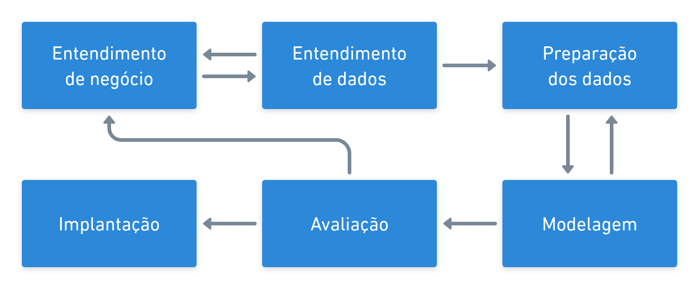
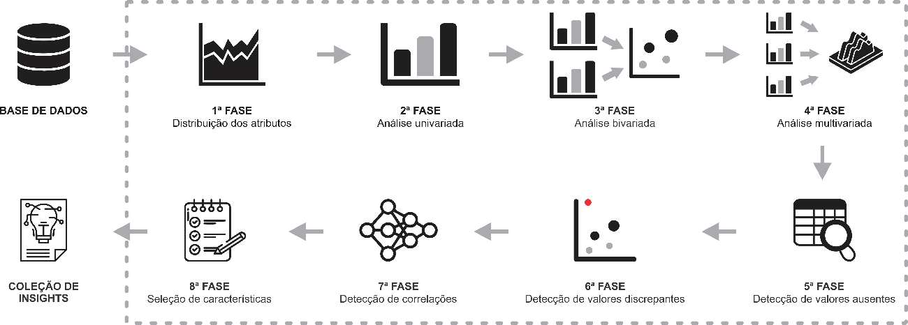

# Metodologia

O projeto será desenvolvido seguindo a metodologia de ciência de dados da área de governança de dados da organização.

## CRISP-DM

Cross-industry standard process for data mining (Processo padrão inter-indústrias para mineração de dados, ou **CRISP-DM**) é uma metodologia desenvolvida em 1999 para padronizar processos industriais de mineração de dados, que fornece uma abordagem clara e bem estruturada para processos que envolvem projetos de ciência de dados em geral (mineração, análise, aprendizado de máquina, etc.).

Mesmo que não mencionada explicitamente, a maioria das equipes de ciência de dados utiliza alguma metodologia similar ao CRISP-DM ou uma combinação dela com outras metodologias de desenvolvimento de software.

### FASES DO CRISP-DM

O CRISP-DM é composto por um conjunto de passos que devem ser seguidos no ciclo de vida de um projeto de ciência de dados. Tais passos (ou etapas) ajudam a planejar, organizar e implementar o projeto de ciência de dados. Além disso, cada um desses passos ajuda a encontrar respostas para as seguintes questões:
- **Entendimento do negócio:** o que o negócio precisa?
- **Entendimento dos dados:** quais dados temos? quais dados precisamos? os dados estão "limpos"?
- **Preparação dos dados:** como organizamos os dados para a etapa de modelagem?
- **Modelagem:** quais técnicas de modelagem podemos aplicar ao nosso problema? E quais devemos utilizar?
- **Avaliação:** qual modelo atende melhor aos objetivos de negócios?
- **Implantação:** como as partes interessadas acessarão os resultados do projeto?

Uma visão geral do CRISP-DM é apresentada na Figura abaixo.

#### ENTENDIMENTO DE NEGÓCIO

A etapa de entendimento de negócio se destina à compreensão dos objetivos e requisitos do projeto. Essa etapa pode ser dividida em quatro tarefas, a saber:

- **Determinar os objetivos de negócio:** nessa etapa a equipe deve "entender completamente, de uma perspectiva de negócios, o que o cliente realmente deseja realizar" e, em seguida, definir os critérios de sucesso do negócio.
- **Avaliar a situação:** após definir os critérios de sucesso, deve-se determinar a disponibilidade de recursos, os requisitos do projeto, avaliar os riscos e contingências e conduzir uma análise de custo-benefício.
- **Determinar as metas de mineração de dados:** além de definir os objetivos de negócios, a equipe também deve definir o que é sucesso de uma perspectiva técnica de mineração de dados.
- **Produzir o plano do projeto:** selecionar tecnologias e ferramentas e definir planos detalhados para cada fase do projeto.

Embora muitas equipes passem rapidamente por essa fase, estabelecer um forte entendimento de negócios é absolutamente essencial. Como você deve ter notado, além da terceira tarefa, as outras três tarefas nesta fase são atividades básicas de gerenciamento de projetos que são universais para a maioria dos projetos.

#### ENTENDIMENTO DOS DADOS

Adicionalmente à etapa de entendimento de negócio, a etapa de entendimento dos dados direciona o foco para identificar, coletar e analisar os conjuntos de dados que podem ajudá-lo a cumprir os objetivos do projeto. Esta fase também possui quatro tarefas:

- **Coletar os dados iniciais:** adquirir os dados necessários e (se necessário) carregá-los em ferramentas de análise.
- **Descrever os dados:** examinar os dados e documentar suas propriedades superficiais, como formato de dados, número de registros ou identidades de variáveis.
- **Explorar os dados:** realizar uma análise mais aprofundada nos dados. Consultar, visualizar e identificar relações entre dados e variáveis.
- **Verificar a qualidade dos dados:** realizar análises a respeito da qualidade dos dados: o quão limpos são? Também é necessário documentar qualquer tipo de problema de qualidade dos dados.

#### PREPARAÇÃO DOS DADOS

Esta etapa é necessária para efetuar a preparação dos conjuntos de dados que serão utilizados na etapa de modelagem. É uma das etapas mais importantes, pois afeta diretamente a possibilidade de bons resultados na etapa de modelagem. Ela geralmente é composta por cinco tarefas:

- **Selecionar os dados:** determinar quais conjuntos de dados serão utilizados e documentar os motivos para inclusão ou exclusão.
- **Limpar dados:** frequentemente, essa é a tarefa mais demorada. Uma prática comum durante essa tarefa é corrigir, imputar ou remover valores erroneamente inseridos nos conjuntos de dados.
- **Construir dados:** derivar novos atributos que serão úteis. Por exemplo, derivar o índice de massa corporal de alguém a partir dos campos de altura e peso.
- **Integrar dados:** criar novos conjuntos de dados combinando dados de várias fontes.
- **Formatar dados:** formatar novamente os dados conforme as necessidades dos modelos (por exemplo, converter valores de texto em formato numérico).

#### MODELAGEM

Nesta etapa, as equipes provavelmente construirão e avaliarão vários modelos com base em técnicas de modelagem diferentes. Esta fase possui as seguintes tarefas:

- **Selecionar as técnicas de modelagem:** determinar quais métodos/modelos serão utilizados (por exemplo, clustering, redes neurais). A escolha do modelo depende do tipo de problema e da aplicação.
- **Gerar desenho do experimento:** criar um experimento para que os modelos selecionados possam ser comparados utilizando os conjuntos de dados disponíveis.
- **Construir os modelos:** realizar o treinamento dos modelos de acordo com o experimento desenhado.
- **Avaliar modelos:** comparar os modelos de acordo com as métricas capturadas para selecionar o mais adequado para a próxima etapa.

Geralmente, as tarefas são repetidas até que a equipe encontre o melhor modelo (ou um modelo suficientemente bom para a aplicação).

#### AVALIAÇÃO

Enquanto a tarefa de "avaliar modelos" na fase de Modelagem se concentra na avaliação técnica do modelo, a fase de Avaliação analisa mais amplamente qual modelo atende melhor ao negócio e o que fazer a seguir. Esta fase possui três tarefas:

- **Avaliar os resultados:** os modelos atendem aos critérios de sucesso do negócio? Qual (ou quais) devem ser aprovados para o negócio?
- **Revisar o processo:** análise do trabalho realizado. Alguma coisa foi esquecida? Todas as etapas foram executadas corretamente?
- **Determinar as próximas etapas:** determinar se a equipe deseja prosseguir com a implantação, iterar mais ou iniciar novos projetos.

#### IMPLANTAÇÃO

Esta fase final possui quatro tarefas:

- **Planejar a implantação:** desenvolver e documentar um plano de implantação do modelo.
- **Planejar o monitoramento e manutenção dos modelos:** desenvolver um plano completo para evitar degradação operacional pós-projeto.
- **Produzir o relatório final:** documentar um resumo do projeto e a apresentação final dos resultados.
- **Revisar o projeto:** conduzir uma retrospectiva sobre o que deu certo e o que pode melhorar no futuro.

---

## Análise Exploratória

Nesta fase, é realizada uma análise exploratória dos dados seguindo as etapas apresentadas a seguir:

Realizar análise sobre a distribuição de cada uma das características mapeando possibilidades:

1. **Análise estatística univariada:** analisa a distribuição e dispersão dos dados (frequências, localização, dispersão, assimetria e curtose).
2. **Avaliação estatística da causalidade:** investiga se a variação de uma característica pode ser explicada por outra medida.
3. **Análise multivariada:** encontra padrões e relações entre múltiplas variáveis simultaneamente.
4. **Detecção de valores ausentes:** mensura o impacto e a extensão da ausência de dados no conjunto em estudo.
5. **Detecção de outliers:** identifica padrões com comportamento atípico ou anômalo.
6. **Correlação e associação:** mapeia relações estatísticas lineares ou não lineares entre as variáveis.
7. **Seleção de características:** busca a combinação adequada de atributos mais relevantes para o aprendizado do modelo.

---

## Tecnologia e Ferramentas

No campo da Ciência de Dados, almeja-se extrair insights significativos sobre os dados do projeto para os interessados da área de negócio, utilizando uma abordagem multidisciplinar que combina princípios de matemática, estatística, inteligência artificial e engenharia da computação.

| Ferramenta | Descrição |
| :--- | :--- |
| **Git / GitHub** | Gerenciamento e controle de versões do projeto. |
| **`uv`** | Gerenciamento rápido de dependências e ambientes virtuais. |
| **`uv python`** | Controle da versão do interpretador Python (Python 3.12.x). |
| **Jupyter Notebook** | Ambiente interativo para prototipagem e execução de scripts. |
| **Python** | Linguagem principal para atividades de ETL, análise exploratória e modelagem. |
| **Bibliotecas Data Science** | Pandas, NumPy, Scikit-Learn, Matplotlib, Seaborn, Plotly e Polars. |
