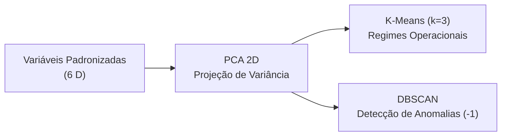

# Modelagem dos dados

Esta página descreve **o desenho do experimento de modelagem**: qual problema o modelo resolve, sobre que unidade de análise ele opera, quais variáveis entram, qual técnica foi escolhida e como o resultado é avaliado.

---

## Problema

Segmentar a frota de equipamentos industriais em regimes operacionais bem definidos e isolar anomalias de sensores, sem utilizar rótulos prévios de falha durante o aprendizado (atendendo aos **Objetivos 1 e 2** dos [critérios de sucesso](criterios-sucesso.md)).

Toda a pipeline de modelagem está implementada no notebook **`notebooks/3.0-modelagem.ipynb`**.

---

## Unidade de análise

Um registro por **ciclo operacional individual de usinagem** (`data/processed/ai4i2020_processed.parquet`).

**Justificativa:** A modelagem opera no grão fino de ciclo de trabalho (`UDI`) para capturar oscilações momentâneas de temperatura, rotação e torque. Agrupar os dados previamente por máquina eliminaria a capacidade de identificar picos pontuais de sobrecarga e anomalias transientes isoladas pelo DBSCAN.

---

## Variáveis

| Critério pede | Variável usada | Observação |
|:---|:---|:---|
| Regime de Qualidade | `Type` | Codificado ordinalmente (0 = Low, 1 = Medium, 2 = High) |
| Sensores Térmicos | `Air temperature [K]`, `Process temperature [K]` | Medições padronizadas de temperatura |
| Sensores Mecânicos | `Rotational speed [rpm]`, `Torque [Nm]` | Medições padronizadas de desempenho dinâmico |
| Desgaste do Componente | `Tool wear [min]` | Tempo acumulado de uso da ferramenta de corte |

### Pré-processamento

* **Isolamento de Rótulos (PBL):** Separação estrita das colunas de identificação e falha (`Machine failure`, `TWF`, `HDF`, etc.).
* **Padronização (`StandardScaler`):** Média $\mu=0$ e desvio padrão $\sigma=1$ aplicados em todas as variáveis numéricas continuas para garantir peso uniforme no cálculo da distância euclidiana.

---

## Técnica

A abordagem não supervisionada combina **Análise de Componentes Principais (PCA)** para redução de dimensionalidade, **K-Means** para segmentação de regimes e **DBSCAN** para detecção de anomalias por densidade:

**Detalhamento do Pipeline:
Redução Dimensional (PCA):
Redução do espaço de 6D para 2 componentes principais ($PC_1$ e $PC_2$), retendo 62,53% da variância explicada acumulada.
Clusterização Particional (K-Means):
Executada sobre a base completa para particionar as máquinas em $k=3$ agrupamentos operacionais.
Clusterização por Densidade (DBSCAN): 
Configurada com eps=1.2 e min_samples=15 para rotular pontos isolados de baixa densidade como anomalias (Cluster -1)..**

## Avaliação do modelo

| Métrica | Leitura |
|:---|:---|
| Método do Cotovelo (Inércia / WCSS) | Quanto menor, maior a compactação interna dos clusters. Apresentou ponto de inflexão (cotovelo) claro em $k=3$. |
| Coeficiente de Silhueta (Silhouette Score) | Varia de -1 a +1; quanto maior, melhor a separação entre agrupamentos. Confirmou $k=3$ como a estrutura mais coesa. |
| Porcentagem de Variância Explicada (PCA) | Quanto maior, melhor a representatividade dos dados originais. O espaço 2D retém 62,53% da informação total. |

**Como se trata de um problema de aprendizado não supervisionado, não há divisão tradicional em treino/teste ou validação cruzada supervisionada. O experimento avaliou a estabilidade da inércia e do silhouette score para variações de $k \in [2, 10]$ no K-Means e variação de eps no DBSCAN.**

!!! warning "Ressalva de métrica"
O Silhouette Score calcula distâncias euclidianas globais e pode penalizar clusters com geometrias não esféricas ou densidades variadas. Por isso, a definição de $k=3$ combinou a métrica de silhueta com a interpretação física dos centróides no domínio industrial.

## Interpretação do resultado

**A tradução dos clusters para a linguagem de negócio do chão de fábrica revelou 3 personas operacionais distintas:**

Cluster 0 (Regime Térmico / Sobreaquecimento): Máquinas operando com temperaturas elevadas de ar e processo. Representa o grupo de maior risco operacional.

Cluster 1 (Regime de Carga Elevada / Alto Torque): Máquinas trabalhando com alto torque e menor rotação, sob forte solicitação mecânica.

Cluster 2 (Regime Severo / Desgaste Acelerado): Equipamentos operando próximo ao limite de tempo de uso da ferramenta.

Anomalias DBSCAN (Cluster -1): 110 ciclos operacionais identificados com comportamentos discrepantes nos limites do plano PCA.

## Saídas

| Arquivo | Conteúdo |
|:---|:---|
| `data/processed/ai4i2020_processed.parquet` | Base limpa e padronizada enviada para a modelagem; |
| `data/processed/ai4i2020_pca_dbscan.parquet` | Dataset com coordenadas PCA ($PC_1, PC_2$) e rótulos de cluster atribuídos |
| `reports/figures/elbow_method.png` | Gráfico do Método do Cotovelo e Silhueta para K-Means |
| `reports/figures/pca_clusters.png` | Gráfico de dispersão 2D dos clusters K-Means e outliers DBSCAN |
