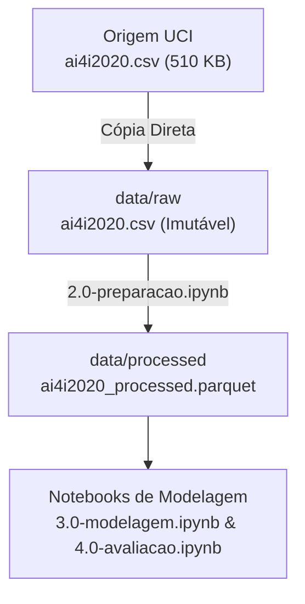

# Preparação dos dados

Esta página descreve **o que foi feito com os dados** entre a origem e a análise: como eles
são materializados, que regras de limpeza foram aplicadas e como a transformação é
conferida.


## Arquitetura em camadas



| Camada | Diretório | Papel |
|:---|:---|:---|
| Bruta | `data/raw` | Cópia imutável do arquivo bruto original da UCI (ai4i2020.csv). |
| Curada | `data/processed/` | Base tratada, padronizada (StandardScaler) e codificada (OrdinalEncoder), salva em Parquet (ai4i2020_processed.parquet). |
| Agregada / Modelagem | `data/processed/` | Subconjunto de características operacionais selecionadas sem rótulos de falha. |

## Materialização da camada bruta

O arquivo original da UCI foi baixado e armazenado de forma imutável no repositório local:

```
data/raw/nome_do_arquivo_particao=valor.parquet
```

## Explicação:
Granularidade (Grão): Cada registro (linha) representa um ciclo operacional individual de usinagem da máquina identificado pela coluna UDI. A granularidade fina no nível de ciclo operacional foi mantida para permitir a análise detalhada de variações térmicas e mecânicas instante a instante.

Formato de Armazenamento: O arquivo foi mantido no formato CSV (Comma-Separated Values).

Por que esta abordagem foi adotada?

Garantia de Imutabilidade: A cópia bruta em data/raw/ funciona como a única fonte de verdade imutável do projeto. Nenhuma alteração, limpeza ou filtro é realizado diretamente sobre esse arquivo, garantindo que qualquer pipeline de tratamento possa ser reexecutada do zero sem o risco de contaminação ou perda irreversível de dados.

Reprodutibilidade e Auditabilidade: Manter o arquivo bruto em formato texto estruturado (CSV) idêntico à fonte oficial do repositório UCI permite auditar o fluxo de ETL de ponta a ponta e garante a reprodutibilidade exata do ambiente em qualquer nova máquina.

<span style="color:red">**Diga se a operação é idempotente e o que garante isso (manifesto,
arquivo de controle, conferência de contagem contra a origem).**</span>

A operação de leitura é completamente idempotente. Ao reexecutar o notebook 2.0-preparacao.ipynb, a base bruta em data/raw/ é lida de forma somente leitura, tratada em memória e exportada sobrescrevendo a camada processada.

!!! note "Decisão técnica (opcional)"
    A camada curada foi salva em formato Apache Parquet (.parquet). O Parquet preserva a tipagem nativa de cada coluna do Pandas (ex.: float64, int64), comprime o tamanho em disco e acelera o tempo de leitura para as etapas de modelagem.

## Regras de limpeza

As transformações foram executadas de forma concentrada no notebook notebooks/2.0-preparacao.ipynb:

| # | Regra | Motivo |
|:-:|:---|:---|
| 1 | Remoção de Identificadores e Rótulos: Isolamento de UDI, Product ID e de todas as colunas de falha (Machine failure, TWF, HDF, PWF, OSF, RNF) no dataframe auxiliar df_labels. | Garantir o aprendizado não supervisionado estrito (regra PBL), evitando vazamento de dados (data leakage). |
| 2 | Codificação Ordinal da Variável Type: Conversão da variante de qualidade (L, M, H) para valores discretos ordenados (0, 1, 2) via OrdinalEncoder. |Mapear a hierarquia de qualidade e tolerância do produto sem aumentar a dimensionalidade da base.; |
| 3 | Padronização das Variáveis Contínuas: Aplicação do StandardScaler ($\mu=0, \sigma=1$) sobre as características térmicas, mecânicas e de desgaste. | Eliminar discrepâncias de escala entre diferentes unidades de medida ($K$, $rpm$, $Nm$, $min$), assegurando que nenhuma variável domine indevidamente as distâncias no K-Means e DBSCAN. |

??? note "Regras que costumam aparecer aqui"
    - seleção das colunas que sustentam os objetivos, para reduzir uma tabela larga a um
      conjunto navegável;
    - normalização de texto (`trim`, caixa, acentuação) — sem isso a mesma categoria vira
      várias;
    - conversão de sentinelas em `NULL`, com as exceções deliberadas declaradas;
    - `coalesce` nas métricas, para que somas não virem nulo;
    - renomeação de rótulos longos, para que gráficos e tabelas fiquem legíveis;
    - derivação de colunas novas a partir das existentes.

<span style="color:red">**Se houver dicionário de dados, diga onde ele fica e se registra a
expressão que origina cada coluna curada — é o que mantém a rastreabilidade até o campo
bruto.**</span>

## Conferências

Validações executadas antes de liberar a base para a modelagem:

- **contagem de linhas** — Confirmado que a base processada retém 100% das 10.000 linhas originais. Nenhuma linha foi descartada.
- **métricas** — A soma dos rótulos de falha isolados no arquivo auxiliar (`df_labels`) bate exatamente com as 339 falhas totais registradas na base bruta original.
- **efeito da limpeza** — A coluna categórica `Type` manteve suas 3 categorias distintas, sendo codificada com cardinalidade mantida (0 = Low, 1 = Medium, 2 = High).
- **perfil de qualidade** — O diagnóstico de ausência de nulos e estatísticas descritivas das colunas padronizadas fica persistido nos logs de execução do notebook `2.0-preparacao.ipynb`.
- **totais dos agregados** — A base curada final exportada em Parquet reproduz integralmente os 10.000 registros para consumo unificado dos modelos de clustering.

## Agregados

Um agregado por objetivo de negócio, no menor grão que aquele objetivo precisa.

| Agregado | Objetivo | Grão |
|:---|:-:|:---|
| `ai4i2020_processed.parquet` | 1 | Ciclo operacional da máquina (`UDI`) com variáveis padronizadas para agrupamento K-Means |
| `ai4i2020_pca_dbscan.parquet` | 2 | Coordenadas reduzidas em 2D (PCA) e sinalização de ruído/anomalias (`Cluster -1`) |
| `ai4i2020_crosstab_falhas.parquet` | 3 | Agrupamento por cluster e contagem cruzada com os rótulos reais de falha (`Machine failure`) |

A coluna **Objetivo** referencia a numeração dos [critérios de sucesso](criterios-sucesso.md).

## Tratamento de outliers

Análise de Legitimidade: Os valores extremos detectados em velocidade de rotação (Rotational speed) e torque (Torque) foram mantidos na base. Eles representam regimes operacionais reais de alta solicitação da máquina e não erros de medição ou sujeira de digitação.

Ação Adotada: Em vez de descartar os outliers, aplicou-se a padronização Z-score e, na etapa de modelagem, utilizou-se o DBSCAN justamente para agrupar e isolar esses pontos extremos como anomalias operacionais (Cluster -1).

## Reprodução

```bash
# Executa o notebook responsável por ler data/raw e salvar data/processed
uv run jupyter execute notebooks/2.0-preparacao.ipynb
```
